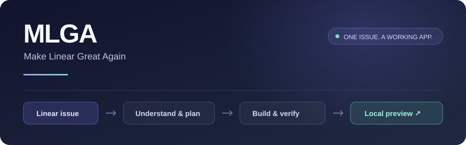

<p align="center">
  
</p>

<p align="center">
  <a href="https://github.com/SomeMedic/mlga/actions/workflows/verify.yml"></a>
  <a href="LICENSE"></a>
  <a href="https://agentskills.io"></a>
</p>

<p align="center"><b>Дайте агенту задачу из Linear. Получите приложение, которое можно открыть и проверить.</b></p>

<p align="center">
  <a href="#быстрый-старт">Установка</a> ·
  <a href="#как-это-работает">Сценарий работы</a> ·
  <a href="#подключение-linear">Подключение Linear</a> ·
  <a href="#проверка-и-разработка">Разработка</a>
</p>

## Что такое MLGA

**MLGA — Make Linear Great Again** — переносимый скилл для coding-агентов. Он связывает задачу в Linear с работой в вашем репозитории: агент читает требования и обсуждение, объясняет задачу, уточняет важные решения, составляет план, пишет код, проверяет результат и оставляет локальное приложение запущенным.

Вы выбираете задачу и проверяете результат. Агент ведёт реализацию до локального демо, а вопросы задаёт там, где нужен ваш продуктовый выбор.

```text
Linear → Разбор → Вопросы → План → Код → Проверки → Local preview
```

## Быстрый старт

Нужны установленный coding-агент, **Node.js 22.20+** и Git. Команды ниже используют проверенную версию [Skills CLI](https://github.com/vercel-labs/skills) — общий установщик открытого формата Agent Skills.

Запускайте из репозитория приложения. Выберите свой агент:

### Codex CLI

```bash
npx --yes skills@1.7.4 add SomeMedic/mlga --skill mlga --agent codex --global --yes
```

Откройте Codex в проекте и напишите:

```text
$mlga Сделай MV-123. Задай нужные вопросы и оставь приложение запущенным локально.
```

Можно установить и через встроенный `skill-installer`: отправьте в Codex следующий запрос.

```text
$skill-installer Install https://github.com/SomeMedic/mlga/tree/main/skills/mlga
```

### Claude Code

```bash
npx --yes skills@1.7.4 add SomeMedic/mlga --skill mlga --agent claude-code --global --yes
```

Затем в Claude Code:

```text
/mlga Сделай MV-123. Задай нужные вопросы и оставь приложение запущенным локально.
```

### Сразу для двух агентов

```bash
npx --yes skills@1.7.4 add SomeMedic/mlga --skill mlga --agent codex claude-code --global --yes
```

`--global` делает скилл доступным во всех ваших проектах. Уберите этот флаг для установки только в текущем проекте. Если скилл не появился, начните новую сессию агента.

> Установка скилла и вход в Linear — два отдельных шага. Если Linear уже подключён в вашем клиенте, можно сразу переходить к задаче.

<details>
<summary><b>Claude Code: установка через встроенный менеджер плагинов</b></summary>

Выберите этот способ вместо Skills CLI, если хотите управлять MLGA как плагином Claude Code.

В терминале:

```bash
claude plugin marketplace add SomeMedic/mlga
claude plugin install mlga@mlga
```

В новой сессии Claude Code команда получает пространство имён плагина:

```text
/mlga:mlga Сделай MV-123 и подними приложение локально.
```

Внутри интерактивного Claude Code доступны соответствующие команды:

```text
/plugin marketplace add SomeMedic/mlga
/plugin install mlga@mlga
```

[Как работают marketplace и плагины Claude Code](https://code.claude.com/docs/en/plugin-marketplaces).

</details>

### Другие агенты

Тот же скилл устанавливается через Skills CLI. Например:

```bash
npx --yes skills@1.7.4 add SomeMedic/mlga --skill mlga --agent cursor opencode gemini-cli --global --yes
```

| Агент | Идентификатор для `--agent` | Как запустить |
| --- | --- | --- |
| Codex CLI | `codex` | `$mlga …` |
| Claude Code | `claude-code` | `/mlga …` или `/mlga:mlga …` для плагина |
| Cursor | `cursor` | Попросите агента использовать MLGA для задачи |
| OpenCode | `opencode` | Попросите агента использовать MLGA для задачи |
| Gemini CLI | `gemini-cli` | Попросите агента использовать MLGA для задачи |

Для каждого клиента нужны его собственные доступ к Linear и инструменты локальной разработки. Автоматическая установка файлов для этих пяти агентов проверяется в CI; выполнение задач зависит от модели, разрешений клиента и самого проекта.

## Подключение Linear

Используйте уже подключённый Linear connector/MCP. Если подключения ещё нет, один раз настройте его в выбранном клиенте.

Для обычного сценария MLGA достаточно чтения задач. Примеры используют официальный endpoint Linear с доступом только на чтение.

**Codex CLI:**

```bash
codex mcp add linear --url https://mcp.linear.app/mcp/readonly
codex mcp login linear
```

**Claude Code:**

```bash
claude mcp add --transport http --scope user linear https://mcp.linear.app/mcp/readonly
```

Затем откройте Claude Code и выполните `/mcp`, чтобы пройти авторизацию. Вход выполняется через OAuth в браузере; ключ API в скилл добавлять не нужно.

Если подключение с именем `linear` уже существует, используйте его. Для других клиентов следуйте [официальной инструкции Linear MCP](https://linear.app/docs/mcp). Авторизация одного клиента не означает, что Linear подключён в остальных.

## Как это работает

| Этап | Что делает агент | Что получаете вы |
| --- | --- | --- |
| Разбор | Читает задачу, обсуждение и важные связи; находит нужный репозиторий | Краткое объяснение задачи и критерии результата |
| Уточнения | Выделяет решения, влияющие на поведение и объём работ | Конкретные вопросы с предлагаемым вариантом |
| План | Сопоставляет требования с текущим кодом и локальным окружением | Понятный план реализации и проверки |
| Реализация | Вносит изменения по правилам проекта | Код, решающий выбранную задачу |
| Проверка | Запускает подходящие тесты и проверяет изменённый сценарий в браузере, если он доступен | Фактические результаты и явно названные пробелы |
| Локальное демо | Поднимает нужные сервисы и оставляет их работающими | Ссылка, тестовый вход при необходимости и шаги для проверки |

Пример запроса:

```text
$mlga Возьми https://linear.app/my-team/issue/APP-123/example.
Сначала объясни задачу и задай важные вопросы.
Реализуй согласованный вариант и оставь приложение локально, чтобы я всё проверил.
```

Можно ограничить этап:

```text
$mlga Разбери APP-123 и предложи план. Код пока не меняй.
```

По умолчанию работа завершается на локальном просмотре. Коммиты, push, PR, деплой, изменения продакшна и записи в Linear выполняются по отдельному запросу. Уже выданное разрешение сохраняет силу. Локальные данные и тестовые аккаунты создаются отдельно от продакшна.

MLGA запускается по вашему сообщению. Для фонового подхвата задач, расписания или реакции на смену статуса нужен отдельный механизм запуска.

## Обновление и удаление

Для установки через Skills CLI:

```bash
# Проверить доступные обновления
npx --yes skills@1.7.4 check

# Обновить глобально установленный MLGA
npx --yes skills@1.7.4 update mlga --global --yes

# Удалить глобальную установку из Codex и Claude Code
npx --yes skills@1.7.4 remove mlga --agent codex claude-code --global --yes
```

Для проекта используйте `update mlga --project --yes` и `remove mlga …` без `--global`.

Для плагина Claude Code:

```bash
claude plugin marketplace update mlga
claude plugin update mlga@mlga
# При необходимости:
claude plugin uninstall mlga@mlga
```

## Если что-то не работает

| Ситуация | Что проверить |
| --- | --- |
| Скилл не появился | Правильный агент и область установки; начните новую сессию |
| В Claude нет `/mlga` | При установке плагином используйте `/mlga:mlga` |
| Linear недоступен | OAuth в текущем клиенте, выбранный workspace и права на задачу |
| Несколько подходящих задач | Укажите ID или ссылку; агент попросит выбрать точную задачу |
| Приложение не запускается | Доступность Docker/зависимостей и локального env; агент должен назвать конкретный блокер |
| Вопросов слишком много | Дайте продуктовый ориентир; технические решения агент получает из кода и документации |

## Проверка и разработка

```bash
git clone https://github.com/SomeMedic/mlga.git
cd mlga
npm test
npm run verify:install
```

`npm test` проверяет целостность дистрибутива, ссылки на локальные ресурсы и согласованность метаданных. `verify:install` выполняет настоящую установку через Skills CLI в временные проекты для пяти агентов, сравнивает все файлы с исходниками и проверяет повторную установку в обычном режиме и с `--copy`. Загрузка установщика требует сети; у MLGA нет runtime-зависимостей и install-скриптов.

CI выполняет эти проверки на Linux, macOS и Windows. Они подтверждают корректную доставку скилла. Качество выполнения задач моделью проверяется отдельно по [сценариям приёмки](docs/acceptance.md).

```text
.claude-plugin/        Каталог и манифест плагина Claude Code
skills/mlga/          Единственный исходник скилла для всех агентов
  SKILL.md            Основной рабочий процесс
  agents/openai.yaml  Метаданные Codex
  references/         Чтение Linear и локальное демо
scripts/              Проверка реальной установки
tests/                Проверки целостности дистрибутива
```

Структура использует [Agent Skills](https://agentskills.io/specification), [локальные скиллы Codex](https://developers.openai.com/codex/skills/) и [скиллы Claude Code](https://code.claude.com/docs/en/skills).

## Лицензия

[MIT](LICENSE) · SomeMedic
